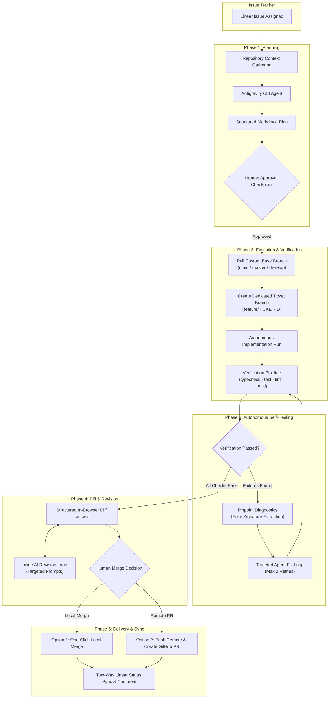

# DevFlow-AI

<div align="center">

[](LICENSE)
[](https://nodejs.org/)
[](https://nextjs.org/)
[](https://www.typescriptlang.org/)
[](tests/unit)
[](#local-first-architecture)

**A production-ready, local-first autonomous AI engineering framework that bridges issue trackers to local coding agents with human-in-the-loop control, pinpoint error tracking, and autonomous self-healing.**

[Features](#core-pillars) • [Architecture](#architecture) • [Quick Start](#quick-start) • [Dashboard Guide](#dashboard-workflows) • [CLI Reference](#cli-reference) • [Configuration](#configuration) • [Security & Guardrails](#security--guardrails)

</div>

---

## Overview

DevFlow-AI transforms how software engineers build software with AI. Instead of relying on brittle copy-pasting or expensive cloud LLM APIs, DevFlow-AI runs **locally on your machine**, binding your issue tracker ([Linear](https://linear.app)) directly to your local coding agent ([Google Antigravity CLI](https://github.com)).

### The Philosophy: Human-in-the-Loop, Autonomous Execution

DevFlow-AI is built around a simple principle: **Humans make decisions; AI handles execution.**

1. **AI plans**: The agent inspects your repository context and generates a structured, verified implementation plan.
2. **Human approves**: You review the plan, API contracts, and risk analysis in the local dashboard.
3. **AI implements & verifies**: Upon explicit confirmation, the agent creates a dedicated branch, implements the code, runs your project's verification suite (`typecheck`, `test`, `lint`, `build`), and automatically diagnoses and heals any errors.
4. **Human reviews diff**: Inspect line-by-line syntax-highlighted diffs in the browser and request revisions if needed.
5. **Human decides**: Choose between a **1-click local merge** into your base branch or an **automated remote push & GitHub Pull Request**.

---

## Architecture



---

## Core Pillars

### 1. Autonomous Self-Healing & Pinpoint Diagnostics
When verification fails, DevFlow-AI does not give up or spit out raw unformatted terminal dumps:
- **Intelligent Error Parser**: Dedicated error signature extractors for TypeScript (`tsc`), Vitest/Jest, ESLint, and Next.js compiler output.
- **Pinpoint Context**: Automatically strips ANSI color codes, deduplicates repeated errors, and extracts exact `file:line:col` coordinates.
- **Bounded Retry Loop**: Hands the extracted diagnostics back to the agent in an autonomous self-healing loop (up to 2 retries) to fix errors before notifying the developer.

### 2. Direct Ticket Branching & One-Click Merge
- **Clean Branch Isolation**: Automatically pulls the latest changes from your chosen base branch (`main`, `master`, `develop`, or custom) and checks out a clean ticket branch (`feature/SAH-10` or a custom branch name).
- **Direct Workspace Workflow**: Operates directly in your repository without fragile Git worktree locks on Windows and macOS.
- **One-Click Merge**: Once checks pass and the diff is reviewed, merge cleanly back into the base branch with a single click.

### 3. Automated Remote Push & GitHub Pull Request Creation
- **Git Remote Detection**: Parses your Git origin remote URL (supporting both HTTPS and SSH formats like `git@github.com:org/repo.git`).
- **Automated PR**: If `GITHUB_TOKEN` is configured, DevFlow-AI pushes the branch and creates a GitHub Pull Request via the official GitHub REST API with ticket titles, descriptions, and verification logs.
- **1-Click Web Fallback**: If no token is provided, DevFlow-AI still pushes the branch and instantly generates a pre-filled GitHub web comparison URL.

### 4. Real-Time SSE Log Streaming & Two-Way Linear Sync
- **Live Server-Sent Events (SSE)**: Streams execution logs, compiler output, and state transitions in real time (`GET /api/sessions/[id]/stream`) straight to an interactive terminal UI with zero polling.
- **Two-Way Linear Status Sync**: Automatically moves tickets from `Todo`/`In Progress` to `In Review` or `Done` when execution completes.
- **Automated Summary Comments**: Posts an audit comment to the Linear issue containing execution durations, verification test results, and file change statistics.

### 5. Interactive In-Browser Diff Viewer & Inline AI Revision
- **Dual-Gutter Unified Diff**: Inspect additions, deletions, line numbers, and file change summaries directly in the dashboard.
- **File Filter Chips**: Filter diffs by file name or toggle individual files open and closed.
- **Inline AI Revision Loop**: Not satisfied with a specific change? Type feedback into the inline revision box to generate a targeted revision plan and apply changes immediately without restarting the entire session.

---

## Prerequisites

Before running DevFlow-AI, ensure your system has:

- **Node.js**: v18.0.0 or higher (`node -v`)
- **Git**: Installed and available in your `PATH` (`git --version`)
- **Google Antigravity CLI**: Installed locally (`agy --version`).
  - Typically located at `%LOCALAPPDATA%\agy\bin\agy.exe` on Windows or `/usr/local/bin/agy` on macOS/Linux.
- *(Optional)* **Linear Account**: Personal API Key from [Linear Settings > API](https://linear.app/settings/api).
- *(Optional)* **GitHub Personal Access Token**: Token with `repo` scope for automated Pull Request creation.

---

## Quick Start

### 1. Clone & Install Dependencies

```bash
git clone https://github.com/your-username/devflow-ai.git
cd devflow-ai
npm install
```

### 2. Configure Environment

Copy `.env.example` to `.env`:

```bash
cp .env.example .env
```

Edit `.env` with your settings:

```env
# Path to Antigravity CLI (agy / agy.exe)
ANTIGRAVITY_BIN_PATH="C:\\Users\\<USER>\\AppData\\Local\\agy\\bin\\agy.exe"

# Whitelist of repository directories DevFlow-AI is permitted to touch
DEVFLOW_ALLOWED_WORKING_DIRS="d:\\projects\\my-app;d:\\projects\\backend"

# Linear Personal API Key (Required for ticket sync)
LINEAR_API_KEY="lin_api_xxxxxxxxxxxxxxxxxxxxxxxx"

# Optional: GitHub Token for automated PR creation
GITHUB_TOKEN="ghp_xxxxxxxxxxxxxxxxxxxxxxxx"
```

### 3. Start the Local Developer Dashboard

```bash
npm run dev
```

Open **[http://localhost:4000](http://localhost:4000)** in your browser.

---

## Dashboard Workflows

The local dashboard is divided into focused workspaces:

| View | Purpose |
| :--- | :--- |
| **Overview** | High-level system health, connected integrations, assigned tickets counter, and recent activity. |
| **My Tickets** | Search, filter, and inspect assigned Linear tickets. View descriptions, acceptance criteria, and comments. Click **Plan** to start implementation planning. |
| **Plan Review** | Inspect generated markdown plans, review risks, and confirm or reject plans with developer feedback. |
| **Active Sessions** | Monitor running and completed implementation sessions with live SSE log streaming, step badges, and verification diagnostics. |
| **Diff Viewer** | Review dual-gutter line-numbered diffs, submit inline AI revision notes, or trigger **One-Click Merge** or **Create PR**. |
| **Repositories** | View allowlisted repositories, active Git branches, and working tree clean/dirty status. |
| **Settings** | Audit active security boundaries, verified binary paths, and secret redaction policies. |

---

## CLI Reference

DevFlow-AI also includes a full-featured CLI for headless execution or scripting:

```bash
# Verify Linear connection and inspect authenticated user
npm run linear:whoami

# List assigned Linear tickets
npm run linear:issues

# Inspect a specific ticket by identifier
npm run linear:issue -- SAH-5

# Generate an implementation plan for a ticket
npm run plan -- --issue SAH-5

# Force-overwrite an existing plan
npm run plan -- --issue SAH-5 --overwrite

# Run an approved implementation session headlessly
npm run implement -- --session <SESSION_ID>

# Build standalone CLI and production Next.js bundle
npm run build
```

---

## Configuration Reference

All settings can be configured via environment variables or `.env`:

| Variable | Description | Default |
| :--- | :--- | :--- |
| `ANTIGRAVITY_BIN_PATH` | Path to the local `agy` / `agy.exe` binary. | `%LOCALAPPDATA%\agy\bin\agy.exe` (Win) or `agy` |
| `DEVFLOW_ALLOWED_WORKING_DIRS` | Semicolon or comma-separated list of allowed repository directories. | Current working directory |
| `DEVFLOW_PLANS_DIR` | Directory where generated markdown plans are stored. | `data/plans` |
| `DEVFLOW_TIMEOUT_MS` | Process timeout for agent executions in milliseconds. | `60000` (1 minute) |
| `LINEAR_API_KEY` | Personal API key for Linear GraphQL API. | `""` *(Optional if using offline mode)* |
| `LINEAR_API_URL` | Linear GraphQL endpoint. | `https://api.linear.app/graphql` |
| `GITHUB_TOKEN` | GitHub Personal Access Token for opening Pull Requests. | `""` *(Falls back to web comparison link)* |
| `DEVFLOW_INTEGRATION_TEST` | Enable opt-in live Antigravity CLI integration test. | `false` |
| `LINEAR_INTEGRATION_TEST` | Enable opt-in live Linear GraphQL integration test. | `false` |

---

## Security & Guardrails

DevFlow-AI is engineered from the ground up with defensive security defaults:

1. **Strict Localhost Binding**: The Next.js dashboard server binds exclusively to `localhost` (`127.0.0.1:4000`) and will not listen on public interfaces.
2. **Repository Allowlist**: Execution is strictly restricted to folders listed in `DEVFLOW_ALLOWED_WORKING_DIRS`. Any path traversal (`../`) or attempts to access unauthorized folders are blocked immediately.
3. **Automated Secret Redaction**: `LINEAR_API_KEY`, `GITHUB_TOKEN`, `.env` contents, `.pem` certificates, and private keys are scrubbed from error messages, API responses, and agent prompts.
4. **Concurrency Locks**: Process-level concurrency locks prevent simultaneous overlapping runs on the same repository or issue.
5. **No Blind Deployments**: DevFlow-AI will never push to production or merge into your base branch without explicit human confirmation.

---

## Verification & Testing

DevFlow-AI maintains a comprehensive test suite covering all services, adapters, diagnostic parsers, and API endpoints:

```bash
# Run TypeScript type check
npm run typecheck

# Run 98 unit tests across 14 test suites
npm test

# Run Next.js production build check
npm run build:next
```

---

## Project Structure

```text
DevFlow-AI/
├── src/
│   ├── app/                      # Next.js App Router (Dashboard & API endpoints)
│   │   ├── layout.tsx            # Global layout with dark theme & typography
│   │   ├── page.tsx              # Main developer dashboard client
│   │   ├── globals.css           # Design tokens, terminal styling, & markdown styles
│   │   └── api/                  # Server-side REST API & SSE streaming
│   │       ├── status/           # System health & secret-redacted settings
│   │       ├── tickets/          # Assigned Linear tickets & details
│   │       ├── repositories/     # Repository allowlist registry & Git status
│   │       ├── plans/            # Plan generation, storage, & review approvals
│   │       └── sessions/         # Execution sessions, diffs, PRs, & SSE log stream
│   ├── components/               # React UI components
│   │   ├── Sidebar.tsx           # Navigation sidebar with connection badges
│   │   ├── OverviewView.tsx      # Overview metrics & quick action cards
│   │   ├── TicketsView.tsx       # Searchable ticket inbox with detail modals
│   │   ├── PlanReviewView.tsx    # Plan review, risk inspection, & decision controls
│   │   ├── ExecutionConfirmationModal.tsx # Pre-flight checklist & branch setup modal
│   │   ├── ExecutionSessionsView.tsx      # SSE live terminal, diff viewer, merge/PR modal
│   │   ├── RepositoriesView.tsx  # Git status & branch inspector
│   │   └── SettingsView.tsx      # Security boundaries & configuration overview
│   ├── adapters/
│   │   ├── antigravity.ts        # Antigravity CLI adapter with safety controls
│   │   └── linear.ts             # Linear GraphQL adapter (Two-way sync & queries)
│   ├── services/
│   │   ├── diagnostics.ts        # Pinpoint error extraction & compiler diagnostics
│   │   ├── executor.ts           # Controlled execution & autonomous self-healing loop
│   │   ├── git-ops.ts            # Git branching, remote push, merge, & diff parsing
│   │   ├── github.ts             # GitHub REST API adapter & web URL generator
│   │   ├── planner.ts            # Repository context gathering & plan generator
│   │   ├── plan-storage.ts       # Plan persistence & review state management
│   │   ├── repo-registry.ts      # Repository allowlist enforcement
│   │   ├── verification.ts       # Verification runner (typecheck, test, lint, build)
│   │   └── execution-storage.ts  # Session storage & Server-Sent Events emitter
│   ├── config/
│   │   └── env.ts                # Zod-validated environment configuration
│   └── types/                    # Shared TypeScript interfaces & schemas
├── tests/
│   ├── unit/                     # 98 unit tests (14 suites) with mock adapters
│   └── integration/              # Opt-in live Antigravity & Linear integration tests
├── data/
│   ├── plans/                    # Stored implementation plans & review decisions
│   └── sessions/                 # Persisted execution sessions & diff logs
├── package.json
└── README.md
```

---

## Contributing

Contributions from the open-source community are very welcome!

1. Fork the repository.
2. Create your feature branch (`git checkout -b feature/amazing-feature`).
3. Commit your changes (`git commit -m "feat: add amazing feature"`).
4. Verify all tests pass (`npm run typecheck && npm test`).
5. Push to the branch (`git push origin feature/amazing-feature`).
6. Open a Pull Request.

---

## License

This project is licensed under the MIT License — see the [LICENSE](LICENSE) file for details.
